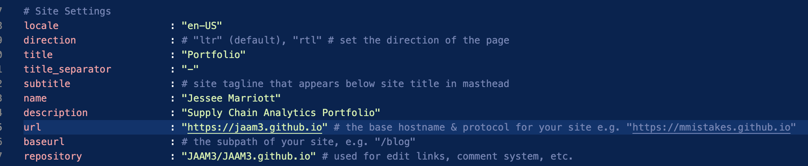
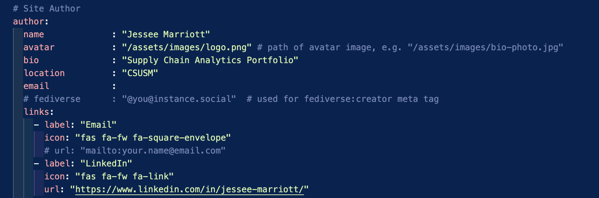

## Introduction
Creating customization for your e-portfolio is easy to do with customer pre-made templates, with many options you may choose from based on personal taste or purpose of portfolio. For my portfolio, I chose to complete the side quest and use the minimal mistakes template.
## GitHub
We created a repository in GitHub and through GitHub desktop we cloned our project. To create our personal page we created a repository with our user name: JAAM/github.io. We adjusted the settings, created a `readme.md` file and commited the changes. A quick start guide can be found here. [GitHub Pages Quickstart](https://docs.github.com/en/pages/quickstart)
## Creating your customization
To create a minimal mistakes portfolio, access it here -  [Minimal-Mistakes](https://github.com/mmistakes/minimal-mistakes)
First clone the respository you created
Then download the zip file to your computer. However, make note that you will only be copying over the contents of that unzipped to to your machine
Once repository was loaded in VS code I took the following steps to set up the customization
-  I first configured `_config.yml` to use the minimal theme adjusting these default settings

- I replaced the placeholder logo with my own headshot

- I edited the root `index.md` with my education, background, and other personal details.

- The minimal mistaks `readme.md` has important information that you are going to want to pay close attention to. When you copy over, make sure you update with your information. 

## The Resulting Page
